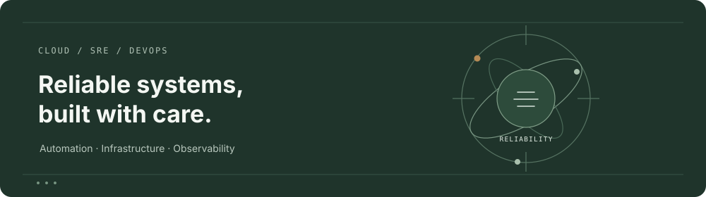
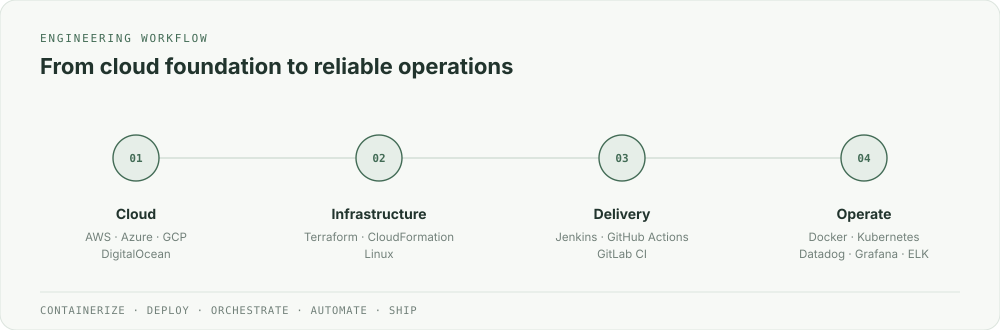
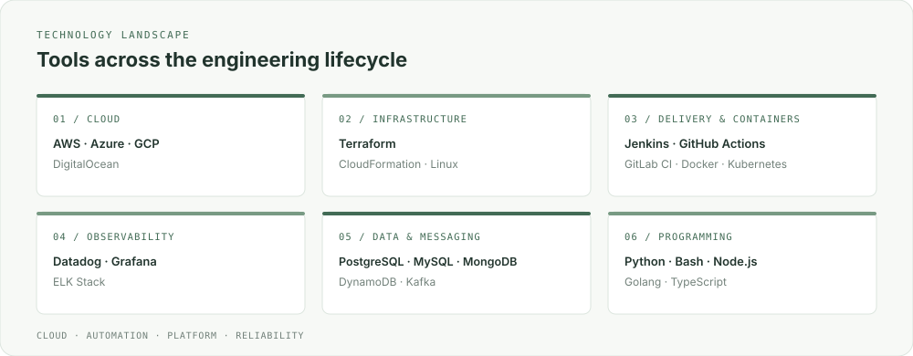

# Rahul Adepu

**Cloud &amp; SRE Engineer**

[LinkedIn](https://www.linkedin.com/in/rahul-adepu-614603151/) · [Email](mailto:rahuladepu99@gmail.com)

---

## About

I'm a **Cloud &amp; SRE Engineer** who enjoys building, automating, and scaling reliable systems in the cloud.

- Cloud Computing graduate with hands-on experience in **AWS, Azure, and GCP**.
- Currently learning **advanced DevOps practices**.
- Interested in collaborating on **DevOps, Cloud, and open-source projects**.
- Enjoy helping teams **ship fast and iterate safely**.
- Topics I enjoy discussing: **containers, CI/CD, Kubernetes, and Linux**.
- Focused on building **efficient, fast, and scalable systems**.
- Always learning and growing.

**Containerize** · **Deploy** · **Orchestrate** · **Automate** · **Ship**

## Engineering workflow

The diagram groups the areas and tools listed in this profile into a practical cloud engineering workflow.

## Technology stack

| Area | Technologies |
| :--- | :--- |
| **Cloud &amp; infrastructure** | AWS · Azure · GCP · DigitalOcean · Linux · Terraform · CloudFormation |
| **DevOps &amp; delivery** | Docker · Kubernetes · Jenkins · GitHub Actions · GitLab CI · GitHub · GitLab |
| **Observability** | Datadog · Grafana · ELK Stack |
| **Databases &amp; messaging** | PostgreSQL · MySQL · MongoDB · DynamoDB · Kafka |
| **Programming &amp; scripting** | Python · Bash / Shell Scripting · Node.js · Golang · TypeScript |

## Connect

I'm open to connecting with people working across **Cloud, DevOps, SRE, and open source**.

[LinkedIn](https://www.linkedin.com/in/rahul-adepu-614603151/) · [rahuladepu99@gmail.com](mailto:rahuladepu99@gmail.com)

